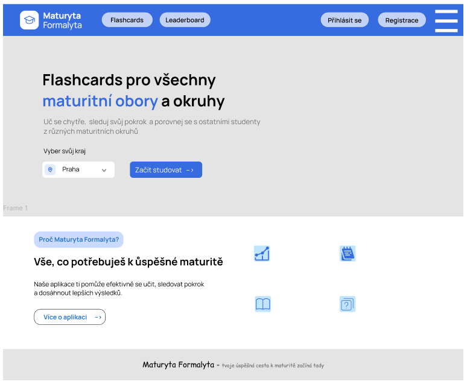
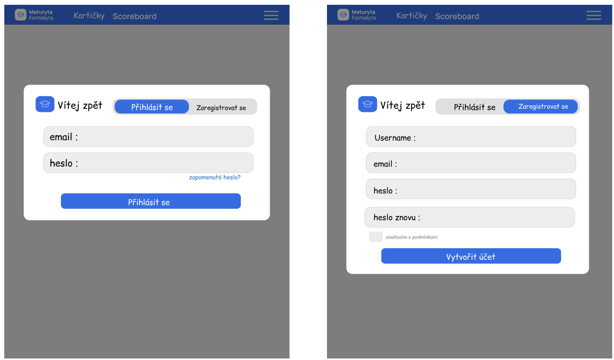
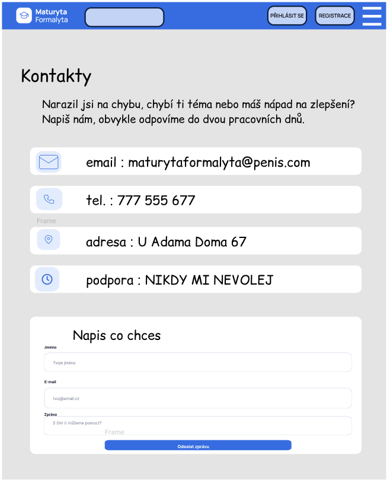
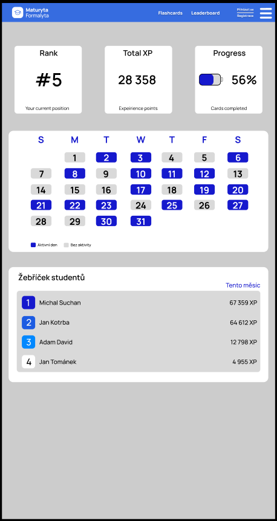
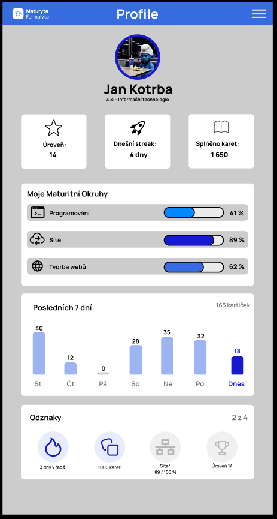

    2. STRUKTURA APLIKACE
====================================
* Seznam všech obrazovek
* Popis jednotlivích sekcí
* Vztahy mezi obrazovkami
* navigace v Aplikaci

    Seznam všech obrazovek
------------------------------------
1.   _"/"_
2.   _"/login"_, _"/register"_
3.         _"/kontakty"_
4.     _"/flashcards?predmet=xxx&okruh=yyy"_
5.   _"/leaderboard"_
6.       _"/profile"_
7. 

  Popis jednotlivých sekcí
------------------------------------
1. *ÚVODNÍ STRÁNKA*
   Hlavní vstupní bod do aplikace. Obsahuje základní informace o projektu, jeho účelu a možnostech využití. Zároveň slouží jako rozcestník pro přístup k ostatním částem aplikace.

2. *REGISTER/LOGIN*
   Sekce určená pro přihlašování a registraci uživatelů. Umožňuje vytvoření nového účtu a následné přihlášení pomocí e-mailu nebo uživatelského jména a hesla.

3. *KONTAKTY*
   Stránka obsahující kontaktní informace a možnosti spojení se správcem aplikace. Uživatel zde nalezne e-mail, telefonní kontakt, adresu a možnost využít kontaktní formulář pro zasílání dotazů nebo stížností.

4. *FLASHCARDS*
   Hlavní studijní část aplikace. Umožňuje procvičování učiva prostřednictvím interaktivních kartiček. Obsah se bude načítat podle zvoleného předmětu a tematického okruhu.

5. *LEADERBOARD*
   Stránka zobrazující žebříček uživatelů podle jejich dosažených výsledků a aktivity. Jejím účelem je umožnit porovnávání výsledků a motivovat uživatele k dalšímu studiu.

6. *USER PROFILE*
   Osobní stránka přihlášeného uživatele. Bude obsahovat základní informace o účtu, přehled aktivity a dosažených výsledků. Počítá se také s možností úpravy uživatelských údajů a odhlášení.

7. *NAVIGACE/BURGER MENU*
   Rozbalovací navigační nabídka dostupná prostřednictvím ikony Burger Menu. Bude sloužit k rychlému přístupu k jednotlivým částem aplikace.

    Vztahy mezi obrazovkami
------------------------------------
1. *ÚVODNÍ STRÁNKA* se bude zobrazovat na endpointu *"/"*.
   Z ní bude možné se prokliknout v horním baru na stránky **Login/Register**, nebo přes **Burger Menu** rozbalit obsáhlejší **Navigaci**. Na stránce se uživatel také bude moci dočíst více informací o samotné aplikaci.

2. *REGISTER/LOGIN* budou stránky s endpointy *"/login"* a *"/register"*.
   Díky nim se bude možné přihlásit do existujícího účtu nebo vytvořit účet nový. Přihlašovat se uživatel bude moci pomocí e-mailu/username a hesla. Při registraci bude zadávat unikátní e-mail, unikátní username, heslo a kontrolní heslo pro ověření jeho shody.
   Po úspěšném přihlášení se button **Login/Register** změní na button **Profile**, který bude odkazovat na **UserProfile**.

3. *KONTAKTY* budou podstránkou s endpointem *"/kontakty"*, dostupnou z menu **Navigace**.
   Na této stránce uživatel nalezne možnosti, jak kontaktovat správce aplikace. Tyto způsoby budou: **E-mailem**, **Telefonicky**, prostřednictvím **Podpory**, nebo poštovně na uvedenou **Adresu**. Zároveň bude možné posílat dotazy, připomínky a stížnosti přímo prostřednictvím aplikace.

4. *FLASHCARDS* budou podstránky s endpointem *"/flashcards?predmet=xxx&okruh=yyy"*.
   Konkrétní obsah stránky se bude odvíjet od parametrů URL. Parametr **predmet** bude určovat vybraný předmět a parametr **okruh** konkrétní tematický okruh. Na základě těchto parametrů se uživateli zobrazí odpovídající sada studijních kartiček.

5. *LEADERBOARD* bude podstránka s endpointem *"/leaderboard"*.
   Bude zobrazovat pořadí uživatelů podle jejich dosažených výsledků. Uživatelé tak budou moci porovnávat svůj pokrok s ostatními.

6. *USER PROFILE* bude podstránka s endpointem *"/profile"*.
   Bude dostupná přihlášeným uživatelům prostřednictvím buttonu **Profile** v horní navigační liště. Na stránce budou zobrazeny informace o uživatelském účtu a jeho aktivitě. Počítá se také s možností správy účtu a odhlášení.

7. *NAVIGACE/BURGER MENU* bude globální navigační prvek dostupný z hlavních obrazovek aplikace.
   Po rozbalení nabídne odkazy na jednotlivé sekce aplikace. Jeho obsah se bude přizpůsobovat podle stavu přihlášení uživatele.

    Navigace v aplikaci
------------------------------------
1. Uživatel bude moci přejít na úvodní stránku kliknutím na logo aplikace nebo příslušnou položku v navigaci.

2. Z úvodní stránky bude možné přejít na přihlašovací nebo registrační stránku prostřednictvím horní navigační lišty.

3. Mezi stránkami **Login** a **Register** bude možné přepínat pomocí odkazů pod příslušnými formuláři.

4. Po úspěšném přihlášení se místo tlačítka **Login/Register** zobrazí tlačítko **Profile**, které povede na uživatelský profil.

5. K jednotlivým veřejným sekcím aplikace, například **Kontakty** a **Leaderboard**, bude možné přistupovat prostřednictvím **Burger Menu**.

6. Do sekce **Flashcards** se uživatel dostane výběrem konkrétního předmětu a tematického okruhu. Výběr bude předán prostřednictvím URL parametrů.

7. Přihlášený uživatel bude moci přejít na svůj profil, kde bude mít k dispozici informace o účtu a možnost odhlášení.

8. Po odhlášení bude uživatel přesměrován zpět na úvodní stránku a bude opět považován za nepřihlášeného.

9. Z ostatních částí aplikace bude možné kdykoliv přejít zpět na úvodní stránku nebo do jiné dostupné sekce prostřednictvím navigační nabídky.