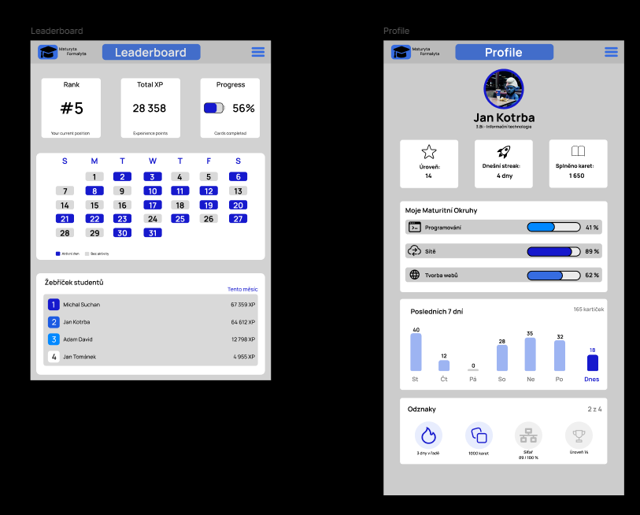

Dokumentace webové aplikace Maturita Formalyta 3. Popis jednotlivých obrazovek

Tato kapitola obsahuje podrobnou technickou a uživatelskou dokumentaci všech obrazovek webové aplikace Maturita Formalyta. Popisuje strukturu rozhraní, účel jednotlivých částí, funkční prvky a interakce v pořadí, v jakém uživatel systémem prochází.  
3.1 Přehled obrazovek

Aplikace Maturita Formalyta sestává z následujících sedmi obrazovek a modálních oken:

    Úvodní stránka (Landing Page): Veřejně přístupný rozcestník a prezentace aplikace.

    Přihlášení (Modální okno): Ověření identity registrovaného uživatele.

    Registrace (Modální okno): Vytvoření nového uživatelského účtu.

    Kontakty: Kontaktní formulář a informace pro podporu.

    Procvičování kartiček (Hlavní rozhraní / Dashboard): Interaktivní výuka pomocí flashcards.

    Žebříček (Leaderboard / Scoreboard): Gamifikační přehled výsledků a pořadí studentů.

    Profil uživatele (Profile): Osobní statistiky, graf aktivity a získané odznaky.

Bez přihlášení jsou dostupné obrazovky Úvodní stránka, Přihlášení, Registrace a Kontakty. Obrazovky Procvičování kartiček a Profil uživatele vyžadují aktivní relaci přihlášeného uživatele. Hlavní navigace probíhá prostřednictvím systémové lišty v záhlaví aplikace.  
3.2 Úvodní stránka (Landing Page)
Vizuální návrh

[Úvodní stránka](image.png)

Úvodní stránka prezentuje webovou aplikaci Maturita Formalyta neregistrovaným návštěvníkům. Vysvětluje účel platformy – efektivní přípravu na maturitní zkoušky za pomoci digitálních učebních kartiček (flashcards) – a směřuje uživatele k přihlášení nebo vytvoření nového účtu.  
Popis jednotlivých prvků

    Logo aplikace: Umístěno v levé části záhlaví. Skládá se z grafické ikony maturitní čepice a textového názvu „Maturita Formalyta“.

    Hlavní navigace (Záhlaví): Lišta obsahující odkazy na sekce „Kartičky“, „Leaderboard“, „Kontakty“ a dvě akční modrá tlačítka „Přihlásit se“ a „Registrovat“.

    Hlavní banner (Hero Section): Obsahuje ústřední nadpis „Flashcards pro všechny maturitní obory a okruhy“. Součástí je výběrové pole pro volbu oboru a vyhledávací tlačítko „Chci učit web“.

    Informační blok výhod: Sekce s nadpisem „Vše, co potřebuješ k úspěšné maturitě“, která pomocí ikon a popisů prezentuje hlavní funkce platformy.

    Zápatí (Footer): Spodní lišta obsahující licenční ujednání a systémové odkazy.

Akce uživatele

Uživatel si může pročítat informace o aplikaci, vybírat požadovaný maturitní obor z rozevíracího seznamu nebo přecházet na registrační a kontaktní formuláře.  
Cíle tlačítek a odkazů

    Tlačítko „Přihlásit se“: Otevře modální dialogové okno s přihlašovacím formulářem.

    Tlačítko „Registrovat“: Otevře modální dialogové okno pro registraci nového účtu.

    Odkaz „Leaderboard“: Přesměruje uživatele na veřejnou část žebříčku studentů.

    Odkaz „Kontakty“: Vede na stránku s kontaktními údaji a formulářem pro dotazy.

3.3 Přihlášení (Modální okno)
Vizuální návrh

[Obrazovka přihlášení](image-1.png)

Modální okno Přihlášení slouží k autentizaci uživatele zadaním platných přihlašovacích údajů před vstupem do chráněné části aplikace.  
Popis jednotlivých prvků

    Záhlaví modálu: Nadpis „Vítej zpět“ a záložkový přepínač mezi kartami „Přihlásit se“ (aktivní) a „Zaregistrovat se“.

    Pole „email:“: Povinné textové pole pro zadání přihlašovací e-mailové adresy uživatele.

    Pole „heslo:“: Povinné textové pole se skrytými znaky pro zadání uživatelského hesla.

    Odkaz „zapomněli jste heslo?“: Textový odkaz umístěný v pravé části pod formulářem pro heslo.

    Tlačítko „Přihlásit se“: Hlavní akční modré tlačítko pro odešlení formuláře.

Akce uživatele

Uživatel vyplňuje svůj registrovaný e-mail a heslo. V případě potřeby může vyvolat postup pro obnovu hesla nebo přepnout záložku na registrační formulář.  
Cíle tlačítek a odkazů

    Tlačítko „Přihlásit se“: Po úspěšném ověření přesměruje uživatele do rozhraní Procvičování kartiček; při chybě zobrazí chybové hlášení.

    Záložka „Zaregistrovat se“: Přepne zobrazení modálu na registrační formulář.

    Odkaz „zapomněli jste heslo?“: Přesměruje uživatele na formulář obnovy zapomenutého hesla.

3.4 Registrace (Modální okno)
Vizuální návrh

[Obrazovka registrace](image-2.png)

Registrační okno umožňuje novému studentovi vytvořit uživatelský účet a získat přístup ke všem výukovým funkcím.  
Popis jednotlivých prvků

    Záhlaví modálu: Nadpis „Vítej zpět“ s přepínacími záložkami „Přihlásit se“ a „Zaregistrovat se“ (aktivní).

    Pole „Username:“: Textové pole pro volbu uživatelské přezdívky zobrazované v žebříčku.

    Pole „email:“: Textové pole pro zadání kontaktní e-mailové adresy.

    Pole „heslo:“: Vstupní pole pro zadání nového hesla.

    Pole „heslo znovu:“: Kontrolní pole pro opätovné zadání hesla z důvodu zamezení překlepům.

    Zaškrtávací pole souhlasu: Checkbox vyžadující potvrzení podmínek použití aplikace.

    Tlačítko „Vytvořit účet“: Modré akční tlačítko odesílající registrační data.

Akce uživatele

Uživatel vyplňuje všechny požadované osobní údaje, nastavuje heslo, potvrzuje souhlas s podmínkami a odesílá registrační požadavky.  
Cíle tlačítek a odkazů

    Tlačítko „Vytvořit účet“: Založí uživatelský profil a při úspěchu automaticky přihlásí uživatele do rozhraní kartiček.

    Záložka „Přihlásit se“: Přepne zobrazení modálu zpět na přihlašovací formulář.

3.5 Kontakty
Vizuální návrh

[Obrazovka kontakty](image-3.png)

Stránka Kontakty poskytuje uživatelům přímé informace na správce systému a formulář pro zasílání zpětné vazby, nápadů či hlášení chyb v otázkách.  
Popis jednotlivých prvků

    Informační bloky:

        E-mailový kontakt: email : maturytaformalyta@penis.com

        Telefonní kontakt: tel. : 777 555 677

        Kontaktní adresa: adresa : U Adama Doma 67

        Informace podpory: podpora : NIKDY MI NEVOLEJ

    Formulář „Napiš co chceš“:

        Pole pro vložení jména odosilatele

        Pole pro kontaktní e-mail

        Víceřádkové textové pole (Textarea) pro zprávu

        Tlačítko pro odeslání zprávy

Akce uživatele

Uživatel si může přečíst dostupné údaje nebo formulářem odeslat zprávu vývojářům aplikace.  
Cíle tlačítek a odkazů

    Tlačítko odeslání formuláře: Odešle vyplněná data na e-mail podpory a zobrazí potvrzení o úspěšném doručení.

3.6 Procvičování kartiček (Dashboard / Hlavní aplikace)
Vizuální návrh

Tato obrazovka představuje jádro aplikace pro přihlášeného studenta. Umožňuje interaktivní procházení, zkoušení a vyhodnocování maturitních okruhů za pomoci učebních kartiček.  
Popis jednotlivých prvků

    Záhlaví aplikace: Obsahuje logo „Maturita Formalyta“, tlačítka navigace „DOMŮ“, „LEADERBOARD“, tlačítko „ODHLÁSIT SE“ a rozbalovací nabídku.

    Levý panel (Maturitní předměty): Seznam tlačítkových předvoleb pro výběr předmětu (např. „SÍTĚ“, „PROGRAMOVÁNÍ“, „TVORBA WEBU“, „DALŠÍ TÉMA“). Vybrané téma je barevně zvýrazněno.

    Středový panel (Interaktivní Kartička):

        Hlavní bílý blok s maturitní otázkou či pojmem (např. „Stojí ti?“).

        Vstupní pole „Vaše odpověď:...“ určené pro psaní odpovědi.

    Pravý panel (Maturitní okruhy): Seznam konkrétních okruhů patřících pod zvolený předmět („okruh 1“, „okruh 2“, „okruh 3“, „okruh 4“, „okruh 5“).

Akce uživatele

Student si zvolí předmět v levém menu a konkrétní okruh v pravém menu. Následně vkládá odpovědi do textového pole středové kartičky a ověřuje své znalosti.  
Cíle tlačítek a odkazů

    Tlačítka předmětů a okruhů: Dynamicky mění zobrazenou sadu otázek ve středovém panelu.

    Tlačítko „LEADERBOARD“: Přesměruje uživatele na obrazovku žebříčku.

    Tlačítko „ODHLÁSIT SE“: Bezpečně ukončí relaci a přejde na úvodní stránku.

3.7 Žebříček (Leaderboard / Scoreboard)
Vizuální návrh

Obrazovka Žebříček zavádí prvky gamifikace. Sleduje výsledky studentů, přiděluje bodové ohodnocení (XP) a zobrazuje porovnání výkonu s ostatními uživateli.  
Popis jednotlivých prvků

    Přehledové karty statistik:

        Rank: Aktuální pořadí přihlášeného studenta (např. #5).

        Total XP: Celkový počet získaných zkušenostních bodů (např. 28 358).

        Progress: Procentuální vyjádření dokončených kartiček (např. 56%).

    Kalendář aktivity (Streak / Activity): Mřížka zobrazující dny v týdnu s barevným odlišením dnů, kdy byl student aktivní.

    Tabulka „Žebříček studentů“: Výsledková tabulka s možností filtrace (např. „Tento měsíc“) zobrazující pořadí, jméno uživatele a celkový počet XP bodů (např. Michal Suchan – 67 359 XP, Jan Kotrba – 64 612 XP).

Akce uživatele

Uživatel vyhodnocuje své celkové umístění, sleduje plnění týdenních cílů v kalendáři a porovnává své výsledky se spolužáky.  
Cíle tlačítek a odkazů

    Odkaz „Flashcards“: Vrací uživatele zpět do rozhraní výukových kartiček.

    Položky v žebříčku: Kliknutí na uživatele umožňuje přechod na detail profilu.

3.8 Profil uživatele (Profile)
Vizuální návrh

Zobrazuje kompletní přehled o studijním pokroku uživatele, historii jeho aktivity v čase, absolvovaných okruzích a získaných odznacích.  
Popis jednotlivých prvků

    Hlavička profilu: Obsahuje profilový avatar, jméno studenta (např. „Jan Kotrba“) a zařazení do třídy/oboru (např. „3.Bi - Informační technologie“).

    Statistické karty:

        Úroveň: Zobrazení dosaženého levelu (např. 14).

        Dnešní streak: Počet dní nepřetržitého učení (např. 4 dny).

        Splněno karet: Celkový počet prošlých kartiček (např. 1 650).

    Sekce „Moje Maturitní Okruhy“: Ukazatele pokroku (Progress bar) pro jednotlivé předměty (Programování – 41 %, Sítě – 89 %, Tvorba webu – 62 %).

    Graf „Posledních 7 dní“: Sloupcový graf znázorňující denní počet procvičených kartiček.

    Sekce „Odznaky“: Přehled získaných ocenění (např. „3 dny v řadě“, „1000 karet“, „Síťař 89/100 %“, „Úroveň 14“).

Akce uživatele

Student analyzuje své slabé a silné stránky v jednotlivých předmětech, kontroluje týdenní graf aktivity a sleduje získané odznaky.  
Cíle tlačítek a odkazů

    Navigační lišta: Vede na obrazovky Procvičování kartiček nebo Žebříček.

